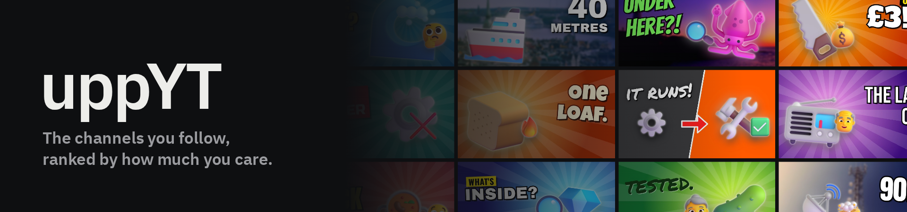
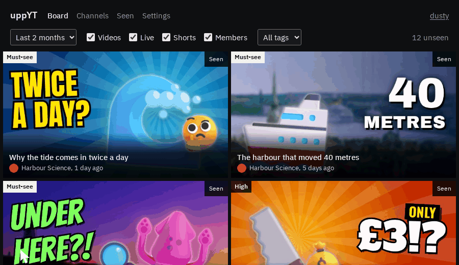
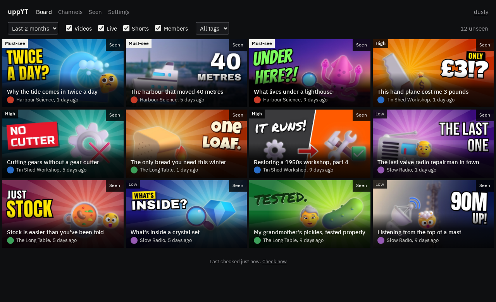
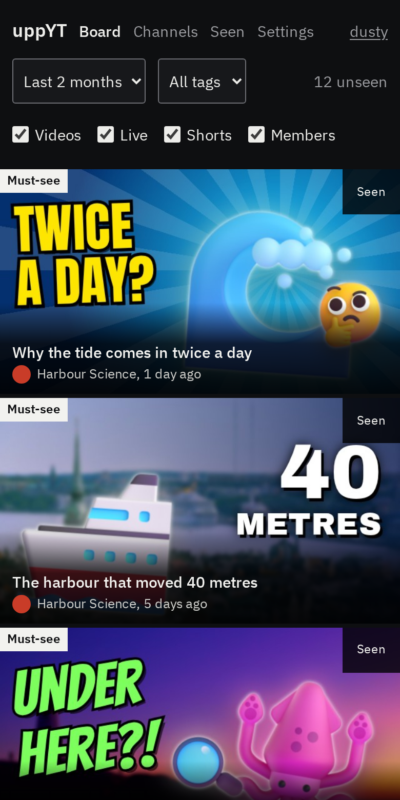
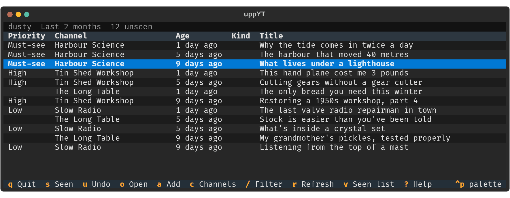
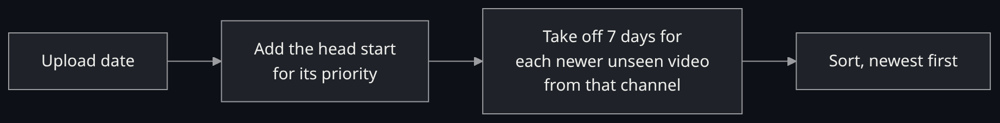
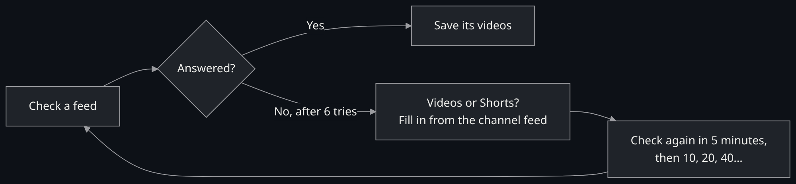
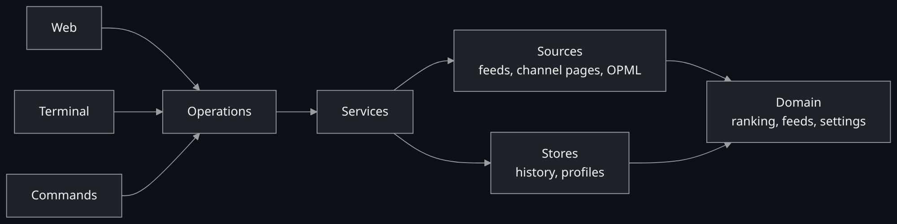

<a href="#readme">
  <picture>
    <source media="(prefers-color-scheme: light)" srcset="docs/img/banner-light.png">
    <source media="(prefers-color-scheme: dark)" srcset="docs/img/banner-dark.png">
    
  </picture>
</a>

<p align="center">
  <a href="https://github.com/dusty369289/uppYT/actions/workflows/tests.yml"></a>
  <a href="LICENSE"></a>
  
  
  
</p>

<p align="center">
  <a href="#start"><b>Start</b></a> &nbsp;·&nbsp;
  <a href="#how-the-board-is-ordered"><b>Ranking</b></a> &nbsp;·&nbsp;
  <a href="#in-the-terminal"><b>Terminal</b></a> &nbsp;·&nbsp;
  <a href="#what-to-expect"><b>Limits</b></a> &nbsp;·&nbsp;
  <a href="#docker"><b>Docker</b></a> &nbsp;·&nbsp;
  <a href="#under-the-hood"><b>Under the hood</b></a>
</p>

YouTube decides what you see next. **uppYT lets you decide.** Give each channel a priority, and recent uploads line up by how much you care about them, not by what an algorithm wants you to click. Clear cards as you watch them. It runs on your own computer, with no account and no API key.

<p align="center">
  
</p>

<sub>The channels and thumbnails in these pictures are made up. <a href="docs/img/CREDITS.md">Credits</a>.</sub>

## Start

You need [uv](https://docs.astral.sh/uv/).

```sh
git clone https://github.com/dusty369289/uppYT
cd uppYT
uv run uppyt
```

It opens in your browser, asks for your name, then asks for a channel. Paste a link like `https://www.youtube.com/@name`, pick a priority, and you have a board.

## One app, three ways in

<table>
  <tr>
    <th width="75%">On your computer: <code>uv run uppyt</code></th>
    <th width="25%">On your phone</th>
  </tr>
  <tr>
    <td valign="top">
      <picture>
        <source media="(prefers-color-scheme: light)" srcset="docs/img/board-light.png">
        
      </picture>
    </td>
    <td valign="top"></td>
  </tr>
  <tr>
    <th colspan="2">In your terminal: <code>uv run uppyt --cli</code></th>
  </tr>
  <tr>
    <td colspan="2"></td>
  </tr>
</table>

| Feature | What it does |
|---|---|
| **Your priorities** | Must-see, High, Normal or Low for each channel, with head starts you can change |
| **Your choice of feeds** | Videos, Live, Shorts and Members, switched on per channel |
| **Nothing gets lost** | Opening a video never clears it. Press **Seen** when you're done, and undo any time |
| **Keeps its history** | Builds up a record of uploads on your computer, beyond what YouTube's feeds list |
| **Tags and filters** | Filter by tag, by kind of video, and by how far back to look |
| **Shared computers** | A profile for each person, with their own channels and seen list |
| **Comes and goes with you** | OPML import and export, so your list works with any RSS reader |
| **Light and dark** | Follows your device, or set it yourself |

## How the board is ordered

Each priority counts as a number of days newer than a video really is. Each further unseen video from the same channel then counts 7 days older, so one busy channel can't fill the top.

<picture>
  <source media="(prefers-color-scheme: light)" srcset="docs/img/diagram-ranking-light.png">
  
</picture>

| Priority | Head start |
|---|---:|
| **Must-see** | 56 days |
| **High** | 28 days |
| **Normal** | 7 days |
| **Low** | 0 days |

Here's how that plays out for four videos from four different channels:

| | Video | Really | Head start | Counts as |
|---:|---|---:|---:|---:|
| 1 | Must-see, 3 days old | −3 | +56 | **+53** |
| 2 | High, 21 days old | −21 | +28 | **+7** |
| 3 | Normal, 1 day old | −1 | +7 | **+6** |
| 4 | Low, from today | 0 | 0 | **0** |

So a 3-week-old High video ranks above yesterday's Normal one. Every number is yours to change in Settings, and a repeat penalty of 0 turns that part off. Time passing doesn't reshuffle anything, so your board stays as you left it until something new arrives.

The board looks back 2 months by default. Change it from the board, or give one channel its own window.

## In the terminal

`uv run uppyt --cli` has every feature of the web app, as dense rows driven by the keyboard.

<kbd>j</kbd> <kbd>k</kbd> move &nbsp; <kbd>s</kbd> seen &nbsp; <kbd>u</kbd> undo &nbsp; <kbd>o</kbd> open &nbsp; <kbd>a</kbd> add &nbsp; <kbd>c</kbd> channels &nbsp; <kbd>v</kbd> seen list &nbsp; <kbd>/</kbd> filter &nbsp; <kbd>r</kbd> refresh &nbsp; <kbd>,</kbd> settings &nbsp; <kbd>i</kbd> import, export, back up &nbsp; <kbd>p</kbd> profile &nbsp; <kbd>?</kbd> help

The web board has <kbd>j</kbd> <kbd>k</kbd> <kbd>s</kbd> <kbd>u</kbd> <kbd>o</kbd> too.

<details>
<summary><b>Commands for scripts and cron</b></summary>

```sh
uppyt channels add @name --priority high --feeds videos,shorts --tags science
uppyt channels lookup @name      # every feed a channel offers
uppyt channels set @name --priority low
uppyt channels ls
uppyt board --limit 10 --json
uppyt seen VIDEO_ID
uppyt seen --undo
uppyt refresh
uppyt import channels.opml
uppyt export channels.opml
uppyt backup
```

If there's more than one profile, choose one with `--profile NAME`, before or after the command (`uppyt --profile NAME board` or `uppyt board --profile NAME`), or set `UPPYT_PROFILE=NAME`. `refresh`, `status` and `backup` cover every profile, so they don't need one. Add `--help` to any command for the rest. From a clone, put `uv run` in front and run it inside the clone. For cron, see below.

</details>

## What to expect

uppYT only reads YouTube's public RSS feeds, plus one page when you add a channel to find its ID and picture. That keeps it simple and free, but feeds have limits, and uppYT is upfront about them.

> [!IMPORTANT]
> **New channels start thin.** Each feed lists only the newest 15 videos, so older ones can't be fetched. The board fills in over time, and each channel's page says where its history starts.

> [!TIP]
> **Keep it running, or schedule it.** uppYT checks hourly while it's open. If a channel uploads more than 15 videos between checks, some can be missed, and its page says when that may have happened. To keep checking while it's closed, schedule a refresh with cron or a timer. Cron starts outside the clone with a short `PATH`, so use the full path to the clone's own command, for example `0 * * * * /path/to/uppYT/.venv/bin/uppyt refresh`. One refresh covers every profile.

> [!NOTE]
> **No search and no durations.** Feeds don't provide them, so channels are added by link, and cards don't show a length.

**Feeds go down.** YouTube's feeds sometimes answer 404 or 500 for channels that are fine. It can pass in under a minute, or go on for hours: on the night of 6 November 2026 they failed on and off for about 7 hours, until about midnight Pacific time. YouTube hasn't said why, and [other](https://github.com/FreeTubeApp/FreeTube/issues/8443) [apps](https://discuss.ai.google.dev/t/youtube-rss-feed-endpoint-returns-404-errors/113379) see it too. For one feed, uppYT works around it like this:

<picture>
  <source media="(prefers-color-scheme: light)" srcset="docs/img/diagram-flaky-feeds-light.png">
  
</picture>

When everything's failing, uppYT says so and asks once per check until feeds come back, then catches up straight away. An outage can only cost you videos if a channel uploads more than 15 before it ends.

## Your data

Everything stays in two folders, both ignored by git:

```
config/<profile>/channels.toml   channels, priorities, feeds and tags. Safe to edit by hand
config/<profile>/settings.toml   only what you've changed
config/<profile>/seen.json       what you've marked as seen
data/catalogue.db                video history, shared by profiles
data/backups/<date and time>/    copies made by Back up
data/avatars/                    channel pictures, saved when a channel is added
```

> [!CAUTION]
> **History can't be downloaded again**, so keep `data/`. Settings has a backup button, or run `uv run uppyt backup`. Backups go inside `data/` too, so copy them somewhere else to survive losing the folder. Set `UPPYT_HOME` to keep all of this somewhere else.

Profiles keep lists apart, but they aren't private: anyone who can open uppYT can open any profile. It only listens on your own computer unless you pass `--host`.

## Docker

```sh
docker compose up -d
```

It's published on `http://localhost:8770`, for this computer only, and your data lives in a named volume. There are no logins, so put a proxy with authentication in front before exposing it, and add its hostname to `UPPYT_ALLOWED_HOSTS`.

## Under the hood

Server-rendered with FastAPI, Jinja and htmx, so there's no JavaScript build and very little JavaScript. Styles are plain CUBE CSS, and history is in SQLite. Filtering and marking seen still work with JavaScript off.

<picture>
  <source media="(prefers-color-scheme: light)" srcset="docs/img/diagram-architecture-light.png">
  
</picture>

All three interfaces call the same operations and hold no logic of their own. A test fails if a feature is missing from any of them.

<details>
<summary><b>Developing</b></summary>

```sh
uv run pytest                # everything except the browser and live checks
uv run pytest -m ui          # every page, at five widths, light and dark. Then read .ui-report/index.html
uv run pytest -m live -n 0   # checks that YouTube's formats haven't changed
```

- **Timing review:** a test straying from its usual time stays flagged until it recovers or someone accepts it with a reason.
- **Flaky tests:** a test that fails then passes on the same code stays flagged until someone explains it.
- **Browser checks:** accessibility, overflow, tap targets, keyboard use and page weight, plus a contact sheet of every screen and pixel baselines kept local to your machine.
- **Tests never touch the network**, and their fixtures are recordings of real public feeds.

[`CLAUDE.md`](CLAUDE.md) has the architecture and rules, and [`docs/decisions.md`](docs/decisions.md) has why things are the way they are. `scripts/make_thumbnails.py` makes the example thumbnails, and `scripts/make_readme_assets.py` regenerates these pictures from the running app.

</details>

## Licence

[MIT](LICENSE). IBM Plex Sans is under the [SIL Open Font License](src/uppyt/web/static/fonts/OFL-ibm-plex-sans.txt), and the image credits are [here](docs/img/CREDITS.md). uppYT isn't affiliated with YouTube.
