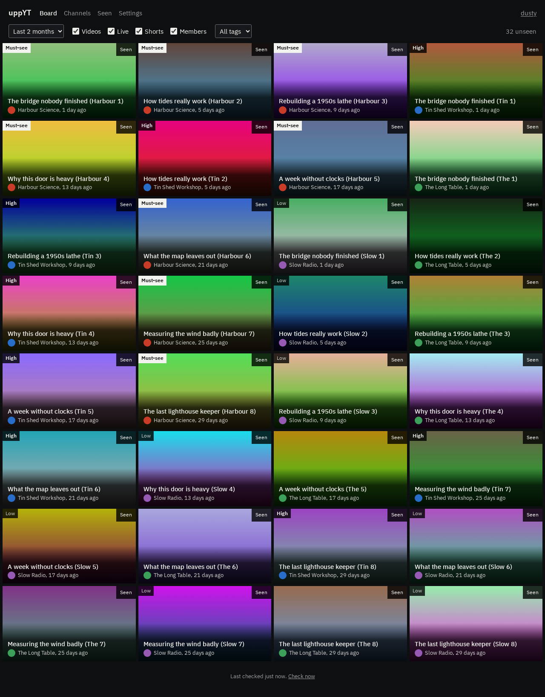

# uppYT

A board of recent uploads from the YouTube channels you follow, ranked by how much you care about each one. Clear cards
as you watch them. No account and no API key, and everything stays on your computer.



## Start

You need [uv](https://docs.astral.sh/uv/).

```sh
git clone https://github.com/dusty369289/uppYT
cd uppYT
uv run uppyt
```

It opens in your browser, asks for your name, then asks for a channel. Paste a link like
`https://www.youtube.com/@name`, choose a priority, and you have a board.

Prefer the terminal? `uv run uppyt --cli` opens the same thing as dense rows of text, driven by the keyboard.

## How the board is ordered

Each priority counts as a number of days newer than a video really is:

| Priority | Head start |
|---|---|
| Must-see | 56 days |
| High | 28 days |
| Normal | 7 days |
| Low | 0 days |

So a 3-week-old High video ranks above yesterday's Normal one. Each further unseen video from the same channel then counts
as 7 days older, so one busy channel can't fill the top. All of these numbers are yours to change in Settings, and a repeat
penalty of 0 turns that part off.

The board looks back 2 months by default. Change it from the board, or give one channel its own window.

Opening a video doesn't clear it. Press **Seen** when you're done with it, and undo if you change your mind.

## What to expect

uppYT only reads YouTube's public RSS feeds, plus one page when you add a channel to find its ID and picture. That keeps it
simple, but feeds have limits, and uppYT is upfront about them:

- **New channels start thin.** Each feed lists only the newest 15 videos, so older ones can't be fetched. The board fills in
  over time, and each channel's page says where its history starts.
- **Keep it running, or schedule it.** uppYT checks hourly while it's open. If a channel uploads more than 15 videos while
  it's closed, some can be missed, and its page says when that may have happened. To check while it's closed, schedule
  `uv run uppyt refresh` with cron or a timer.
- **No search and no durations.** Feeds don't provide them.
- **Feeds can be flaky.** YouTube sometimes answers wrongly at random, so uppYT retries, and tries again later if that fails.

## Your data

```
config/<profile>/channels.toml   channels, priorities, feeds and tags. Safe to edit by hand
config/<profile>/settings.toml   only what you've changed
config/<profile>/seen.json       what you've marked as seen
data/catalogue.db                video history, shared by profiles
```

**History can't be downloaded again**, so keep `data/`. Settings has a backup button, or run `uv run uppyt backup`. Set
`UPPYT_HOME` to keep all of this somewhere else.

Each person can have a profile, with their own channels and seen list. Profiles keep lists apart, but they aren't private:
anyone who can open uppYT can open any profile. It only listens on your own computer unless you pass `--host`.

## From the command line

```sh
uppyt channels add @name --priority high --feeds videos,shorts --tags science
uppyt channels lookup @name      # every feed a channel offers
uppyt channels set @name --priority low
uppyt channels ls
uppyt board --limit 10 --json
uppyt seen VIDEO_ID
uppyt seen --undo
uppyt refresh
uppyt import channels.opml
uppyt export channels.opml
```

Add `--profile NAME` if there's more than one profile, and `--help` to any command for the rest. From a clone, put `uv run`
in front.

### Terminal keys

`j`/`k` move, `s` seen, `u` undo, `o` open, `a` add a channel, `c` channels, `v` seen list, `/` filter, `r` refresh, `,` settings,
`i` import, export and back up, `p` switch profile, `?` help, `q` quit.

The web board has `j`, `k`, `s`, `u` and `o` too.

## Docker

```sh
docker compose up -d
```

It's published on `http://localhost:8770`, for this computer only. Your data lives in a named volume. There are no logins, so
put a proxy with authentication in front before exposing it, and add its hostname to `UPPYT_ALLOWED_HOSTS`.

## Developing

```sh
uv run pytest            # everything except the browser and live checks
uv run pytest -m ui      # every page, at five widths, light and dark. Then read .ui-report/index.html
uv run pytest -m live -n 0   # checks that YouTube's formats haven't changed
```

`CLAUDE.md` has the architecture and rules, and `docs/decisions.md` has why things are the way they are.

## Licence

[MIT](LICENSE). IBM Plex Sans is under the [SIL Open Font License](src/uppyt/web/static/fonts/OFL-ibm-plex-sans.txt).
uppYT isn't affiliated with YouTube.
